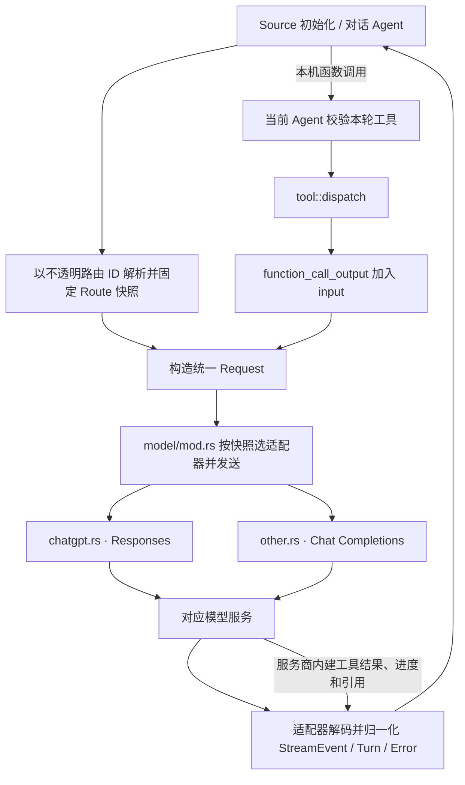
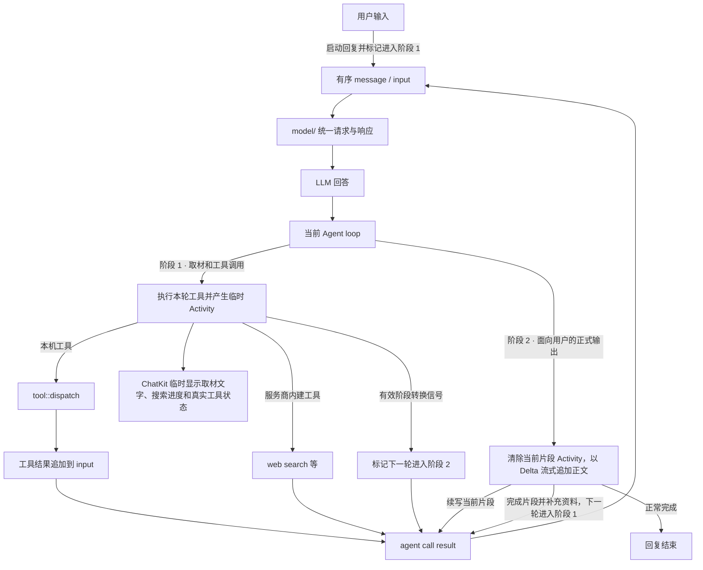

# OpenRead

OpenRead 是面向多学科阅读任务的 Windows 桌面阅读器。用户在一个工作区管理原文，通过模型辅助阅读，并把阅读中形成的讲解、讨论和批注与原文关联起来。

阅读工作区有三个产品模块。**Source** 是只读原文。**Explanation** 是围绕材料展开的主对话，产品目标还包括可保存和切换版本的讲解文档。**Annotation** 从原文、讲解或已有讨论中的位置打开局部对话，目标是把讨论整理为可追溯的便签。当前已实现 PDF 阅读、Source 初始化和 Explanation 主对话。Annotation、讲解版本和持久化尚未实现。

## 文档导航

| 文档 | 说明 |
| --- | --- |
| [AGENTS.md](AGENTS.md) | 开工阅读、代码放置、协作施工和安全约定 |
| [ACR 格式草案](ACR/README.md) · [ACR 后端](desktop/backend/acr/README.md) | ACR 产品公约和未来读写实现 |
| [Agent 总览](desktop/backend/agent/README.md) · [统一模型请求与响应](desktop/backend/agent/model/README.md) | Agent 共用接口、显示公约和服务商协议边界 |
| [Source 初始化](desktop/backend/agent/initial/README.md) · [Explanation](desktop/backend/agent/explanation/README.md) · [Annotation Agent](desktop/backend/agent/annotation/README.md) | 对话与初始化工作流 |
| [Agent 工具](desktop/backend/agent/tool/README.md) · [Explanation 工具](desktop/backend/agent/tool/explanation/README.md) · [Source 上下文](desktop/backend/agent/tool/source/README.md) · [共用阅读 skills](desktop/backend/agent/skill/README.md) · [Explanation skills](desktop/backend/agent/skill/explanation/README.md) | 共用工具、Agent 专属工具和提示词内容 |
| [Source 导入与解析](desktop/backend/source/README.md) · [Markdown 锚点](desktop/backend/source/markdown/README.md) | 后端原文读取和稳定定位 |
| [应用框架](desktop/frontend/app_ui/README.md) · [共用 Chat UI](desktop/frontend/agent_ui/chat_ui/README.md) · [Explanation UI](desktop/frontend/agent_ui/explanation_ui/README.md) · [Annotation UI](desktop/frontend/agent_ui/annotation_ui/README.md) | 前端应用、聊天和 Agent 入口 |
| [Source 阅读 UI](desktop/frontend/source_ui/README.md) · [格式阅读器](desktop/frontend/source/README.md) · [PDF](desktop/frontend/source/PDF/README.md) · [Markdown / TeX](desktop/frontend/source/markdown/README.md) | 原文与概览的呈现和交互 |
| [服务商配置](desktop/backend/providers/README.md) · [ChatGPT 授权](desktop/backend/ai-verification/README.md) | 两种模型来源的配置与授权 |

## ACR 文件

ACR（Annotation Co-Reading）是 OpenRead 计划提供的开放阅读档案格式。`.acr` 目标文件使用 ZIP 容器和 JSON 元数据，携带原始 Source、主对话、Explanation 文档及版本、Annotation 便签和完整讨论关系，以及截图等阅读附件。稳定定位使用来源 ID 和适合文件格式的锚点。运行期的临时引用编号不能充当持久 ID。

兼容阅读器应能在没有原文件目录、账号或缓存时重现档案中的阅读内容。ACR 不保存 OAuth token 或 API Key。读入时要校验容器、版本、路径和引用关系并限制解包大小；写入失败时保留旧文件。容器结构和关系仍是草案，应用尚未实现 ACR 导入或导出。详细约定见 [ACR 格式草案](ACR/README.md)。

## 当前实现与项目目标

| 模块 | 当前状态 |
| --- | --- |
| 桌面工作区 | Tauri 欢迎页、设置和 Source/Explanation 双栏框架已实现。会话与 Source 工作区仅在当前运行期存在。 |
| PDF Source | 已实现 PDF 导入、阅读、按页文字解析和页面图像。Markdown 标题、章节及图片源锚点解析已实现，Markdown 文件导入和阅读尚未实现。 |
| Source 初始化 | 已实现 PDF 分段概览。使用页面文字和图像请求模型，概览保存在前后端内存中，供 Explanation 按需读取，不持久化。 |
| Explanation | 已实现五类工作流、学科阅读视角、工具调用、双阶段回复、按需搜索和可点击引用。讲解文档版本及跨会话保存尚未实现。 |
| Annotation | 目标包括选区或页面上下文、浮窗讨论、`comment` / `question` 便签和讨论关系。目前 Agent 与 UI 工作流尚未实现。 |
| 模型和账号 | 已实现 ChatGPT 登录与额度授权、API 服务商配置、模型列表及两种模型路由。Windows 安装环境中的登录、授权和真实模型请求仍待验收。 |
| ACR 与其他格式 | ACR 读写和 PDF 以外的文件导入尚未实现。TXT、EPUB、DOC/DOCX、PPT/PPTX 为产品目标。 |
| Windows 安装包 | 之前生成过 0.1.0 x64 未签名 NSIS 本地包。该包不代表当前工作区已重新打包、安装或完成真实模型验收。 |

本页将当前行为、产品目标和格式草案分开标注。目标或草案内容不代表已实现功能。

## 当前架构

前端负责页面呈现和阅读交互。本地 Rust 后端负责导入原件、校验输入、账号与服务商配置、Agent 工作流及模型协议。Source 按格式在三处配合：`backend/source/` 负责导入和解析，`frontend/source/` 负责呈现和选区，`backend/agent/tool/source/` 负责把解析结果组织成 Agent 可用的上下文。

```text
desktop/
  frontend/                         TypeScript、React、CSS、Vite
    app_ui/                          欢迎页、设置、阅读台和页面状态
    agent_ui/
      chat_ui/                       共用 ChatKit 渲染、输入和模型选择
      explanation_ui/                Explanation 主对话入口
      annotation_ui/                 Annotation 浮窗目标，尚未实现
    source_ui/                       通用 Source 概览视图
    source/
      PDF/                            PDF 阅读、文本选区和区域截图接口
      markdown/                       Markdown / TeX 呈现
  backend/                           Rust、Tauri
    agent/
      model/                          统一模型请求和 Responses / Chat Completions 适配
      tool/                           共用工具注册、调度和 Source 上下文读取
        explanation/                  Explanation 专属工具
        markdown.rs                   按白名单加载内置 Markdown 指引
      initial/                        Source 概览初始化流水线
      skill/                          多 Agent 共用的阅读视角
        explanation/                  Explanation 专属工作流指引
      explanation/                    Explanation 入口、基础提示词和独立 loop
      annotation/                     Annotation Agent 目标；未来 loop 独立放在此处
      chatkit.rs                      本机 ChatKit 协议与运行期线程
      citation.rs                     流式引用标记解析和正文位置计算
    source/                           导入原件、格式解析和稳定锚点
    providers/                        本机 API 服务商配置
    ai-verification/                  ChatGPT 登录和额度授权
    acr/                              ACR 读写目标，目前未实现
ACR/                                  开放格式草案
tests/                                后端、前端和协议测试
```

PDF 页码从 1 开始且包含封面，页内矩形以页面左上角归一化。Markdown 源范围使用从 0 开始的 UTF-8 字节偏移，标题层级作为章节锚点。缩放、滚动和屏幕像素不作为持久定位信息。前后端职责、凭据和输入边界详见 [AGENTS.md](AGENTS.md) 及对应模块 README。

### 技术栈

- 桌面壳与本机命令使用 Tauri 2。后端使用 Rust、Axum、Tokio、Serde 和 reqwest。
- 前端使用 TypeScript、React、Vite 和 ChatKit React。PDF 阅读使用 PDF.js，Markdown 使用 react-markdown / GFM，数学公式使用 KaTeX。
- API Key 服务商走通用 Chat Completions 适配器。ChatGPT 登录路由走 Responses 适配器。用户可在设置表单提交新 API Key，保存后的 Key 与 OAuth token 仅由后端读取并用于请求，界面不读取已保存的 Key。

## Agent 模型请求与响应公约

工作流构造统一 OpenRead 请求，适配器负责服务商协议和流式响应解析，Agent 自己决定工具循环和业务阶段。模型层当前只有 ChatGPT Responses 和通用 Chat Completions 两种适配器。



这套请求与响应边界已由 Source 初始化和 Explanation 使用。完整请求字段、事件、取消与不透明续传上下文约定见[模型 README](desktop/backend/agent/model/README.md)。

## Agent 双阶段显示公约

对话 Agent 的新回复从阶段 1 开始。每个 Agent 自己管理循环、工具集合和阶段转换。下图中的转换工具名称是通用示意，具体名称和校验方式由 Agent 定义。



阶段 1 的可见内容是模型公开输出的过程文字、搜索进度和实际工具状态，不包括隐藏推理或服务商不透明上下文。阶段 2 的 `Delta` 写入同一条助手消息。需要下一片段资料时先完成当前片段，再回阶段 1。取消或错误时清理临时显示，保留已输出正文和已完成引用。

目前 Explanation loop 实现这套显示约定。未来 Annotation 使用共用 `CompletionEvent` 和 ChatKit 显示规则，并自行定义 Agent loop。Source 初始化不是对话 Agent，使用独立进度与结果接口。阶段事件、调用入口和引用解析的职责见 [Agent README](desktop/backend/agent/README.md)。

## Source 初始化

`initial/` 把导入的 PDF 分成有页码边界的片段，并结合页面文字与 PNG 图像更新一份 Markdown 阅读概览。它帮助用户和 Explanation 找到结构、概念关系和后续精读重点，不代替原文，也不直接生成完整讲解。

ChatGPT 路由可按需联网搜索。API Key 路由没有通用搜索实现，会明确说明未执行搜索。概览只保存在阅读器和 `Workspace` 内存中，移除 Source 或退出程序时清除。Source 初始化的调用、取消、分段和失败回退见[初始化 README](desktop/backend/agent/initial/README.md)。

## Explanation

Explanation 是围绕当前 Source 的主对话 Agent。它可以回答独立知识问题、讲解材料、伴读讨论或回顾。需要证据时先读概览，再按需回读 PDF 页面；引用从流式正文标记转换为可点击的 PDF 页或网页注释。

当前 Explanation 每条新回复先在阶段 1 选择工作流并按需取材，随后在阶段 2 组织正式回答。它可以在一条回复内多次回到阶段 1，形成多个正式片段。未来产品目标还包括独立讲解文档、版本生成与切换。当前主对话和消息只保存在进程内存中。实现示例图、工具及阶段控制见[Explanation README](desktop/backend/agent/explanation/README.md)。

## Annotation

Annotation 的目标入口包括选中文字或完整公式、PDF 页面及页面区域。它与锚点分开管理浮窗屏幕位置，允许关闭后恢复讨论、从回复继续追问，并把完整讨论整理为 `comment` 或 `question` 便签。用户无需事先选择便签类型。便签需要关联回完整讨论，ACR 也要保存锚点和关系。

当前 Annotation Agent、浮窗 UI、便签和持久化都尚未实现。其规划接口与共用 Agent 公约的关系见[Annotation README](desktop/backend/agent/annotation/README.md)及 [Annotation UI README](desktop/frontend/agent_ui/annotation_ui/README.md)。

## Windows 构建与发布

开发环境需有 Node.js、Rust MSVC 工具链和 Tauri Windows 构建依赖。在 Windows PowerShell 中运行：

```powershell
cd desktop/frontend
npm ci
$env:CARGO_TARGET_DIR = Join-Path $env:TEMP "openread-target"
npm run tauri -- dev
```

构建本地 NSIS 验收包：

```powershell
$env:CARGO_TARGET_DIR = Join-Path $env:TEMP "openread-target"
npm run tauri -- build
```

安装包位于 `$env:CARGO_TARGET_DIR\release\bundle\nsis\`。构建目录和验收文件放在系统临时目录。未签名本地包不代表正式发布。正式 Windows 包需配置 `VITE_CHATKIT_DOMAIN_KEY` 并登记实际 Tauri origin。真实登录、额度授权和模型请求需要分别从用户入口验收。

正式安装包计划通过 [GitHub Releases](https://github.com/zyc-lIIll/OpenRead/releases) 分发。打包配置和 ChatKit origin 约定见 [Chat UI README](desktop/frontend/agent_ui/chat_ui/README.md)。
