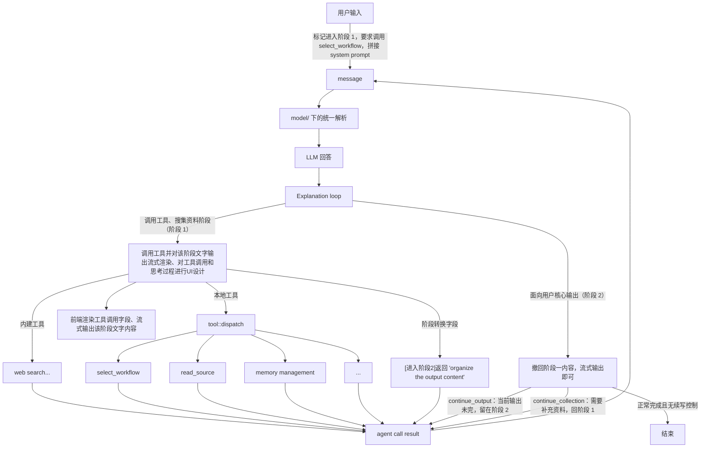

# 本机聊天服务与 Agent 架构

`agent/` 提供 ChatKit 本机服务、统一模型适配、Source 初始化和对话 Agent。Explanation 在自己的模块管理双阶段循环；未来 Annotation 也会拥有自己的循环。对话 Agent 共用回复显示事件和引用解析，但不共用 Agent loop。Annotation 工作流、会话持久化、Explanation 版本文档和 ACR 读写尚未实现。线程、导入原件及概览目前只存在于当前应用运行内存中。

Explanation 的阶段流程、首轮选择及接入边界见[Explanation README](explanation/README.md)；共用显示事件和引用解析约定见本文件。

## 模型适配层

`model/` 是 Agent 工作流使用统一请求和统一响应的唯一入口。`model/mod.rs` 按 `ModelRoute` 选择适配器、发送请求并读取流；`chatgpt.rs` 处理 ChatGPT Responses 协议和不透明续传上下文，`other.rs` 处理通用 API 的 Chat Completions 协议。`initial/` 和每个对话 Agent 各自准备统一请求并消费归一化响应；工作流不拼服务商请求或解析其流。凭据只在后端使用。

模型通过统一请求中的 `tools` 字段获取实际可调用工具名称、JSON Schema 和说明；system prompt 中的工具注册表只说明使用规则，不能代替请求注册。各适配器负责转换目标 API 的工具定义和输入内容。

## Explanation 主对话

`explanation/agent_loop.rs` 拥有 Explanation 的完整请求循环。每条新消息首轮要求 `select_workflow` 选择工作流 prompt 和学科视角，并给出是否建议另开 Explanation 的布尔值。该首轮规则只属于 Explanation。Explanation 自己在取材和正式输出间按校验通过的控制函数反复切换；工具调用和结果使用统一 `input`，Responses 续传项目由模型层保存并作为不透明上下文原样传回。当前最多进行 24 轮模型请求、40 次工具调用和 8 次连续输出截断续写。正式回答按片段流式写入同一条 ChatKit 助手消息。

共享 Source 工具位于 `tool/`：`list_sources` 列出当前导入 PDF、`get_overview` 获取首版初始化概览、`read_source` 按页读取 PDF 正文。`read_source` 单次最多 5 页；未初始化的 Source 仍可以读取原文。`web_search` 是统一搜索意图；ChatGPT 适配器映射为内建搜索，通用 API 适配器会明确告知模型当前没有搜索实现，不会伪造搜索结果。

引用协议使用 `[[cite:rN]]` 表示 `read_source` 实际返回的 PDF 页，`[[cite:wN]]` 表示取材阶段搜索实际返回的网页来源。网页来源目录作为不可信资料追加到有序 `input`，固定引用规则留在 system instructions。共用 `agent/citation.rs` 在流式处理中隐藏标记、验证编号并记录正式正文位置；ChatKit 再将引用转成 Entity 或 URL 注释。PDF 引用携带 Source ID 与页码，点击后前端切换 Source 并跳页。运行时引用不持久化，ACR 尚未接入。该解析器与 Agent loop 无关，可由其他对话 Agent 复用。

## Source 初始化（首版已实现）

`agent/initial/` 接收 Source ID、模型路由 ID 和思考强度；不接收任意文件路径。后端通过 `Workspace` 校验导入项；PDF 专属的上下文获取和切分位于 `agent/tool/source/pdf.rs`。它通过 PDF.js 桥接按页读取文字，并请求对应页的 PNG 图像。初始化最多同时运行一项，前端可查看进度并取消。ChatGPT 思考强度使用设置中的默认值，API Key 路由不读取该参数。

每轮最多包含 12,000 个 Unicode 字符和 8 页图像；文字与 PNG 页图在同一个模型请求中发送，页图最长边不超过 2,048 px。无文字层的页面仍以图像提供，不做本地 OCR。页面渲染失败或模型拒绝图像输入时会回退到可用文字，并将受影响页码列入初始化说明。

每轮请求都发送固定 system instructions，以及包含上一版完整概览、本轮新增原文和页码范围的 user input。下一部分关注点保存在上一版 Markdown 中，没有独立字段。页边界处模型可通过 Markdown 隐藏标记建议从第一未读页开始的连续范围，最多 8 页；后端验证后再应用，缺少或无效时按字符数和页数默认切分。模型返回完整更新后的 Markdown 正文，正文上限为 6,000 字符；若超出，额外请求一次压缩，仍超限则报错。阅读限制提示和搜索来源以结构化附加内容返回，不计入正文上限。概览优先保留全文结构、各部分作用、关键概念及关系和原文页码。它是有损导航索引，不替代原文或 Explanation；具体解释和引用仍需回读原文。

初始化提示词位于 `agent/initial/mod.rs`。它把原文和既有概览作为不可信参考资料，要求模型维护层级结构、概念关系、页码和精读关注点；分段处理中逐段指出下一部分关注点。最后一个原文分段带专属 system 指令，要求模型完成概览并判断是否值得补充搜索，然后直接返回最终 Markdown，不再额外调用一次全文整理。固定提示词不包含最终搜索指令。

默认模型和 ChatGPT 默认思考强度分别设置。自动模式不发送 `reasoning.effort`；选择低、中或高时，只给 ChatGPT Responses API 请求附加对应值。主对话在聊天框中可覆盖默认值；Source 初始化使用默认值。显式强度请求遇到 HTTP 400 时不自动切换强度，并提示用户检查模型支持情况。API Key 请求不显示该选项、不传参数；初始化 IPC 在 API 路由时使用自动值。

API 路由通过 Chat Completions 更新概览，不提供联网工具，概览会注明未检索外部资料。ChatGPT 路由通过 Responses API 在每个分段请求中提供 `web_search` 和 `tool_choice: auto`，允许模型在中间或最后一个分段自行搜索；提示词在最后一个分段鼓励一次补充搜索，若中间已覆盖则可不重复。搜索来源会单独列出并去重。HTTP 400 时先不带搜索工具重试；服务商明确指出图像输入不受支持，或携图请求返回 HTTP 413 时，会回退到文字请求，并告知模型哪些页图已省略。若最后一段没有可读文字或页面图像，模型会整理现有概览并注明未纳入的页码。其他请求错误仍报告失败。SIWC 是否能搜索仍受模型、账号及组织策略限制。参考 [OpenAI Web Search 文档](https://developers.openai.com/api/docs/guides/tools-web-search) 和 [Sign in with ChatGPT 限制](https://developers.openai.com/siwc/token-sharing-open-source/preview-limitations)。

Markdown 概览保存在前端阅读器和后端 Workspace 内存中：返回时保留，移除 Source 或退出应用时清除；不写入 ACR，也不自动注入聊天上下文。Explanation 可按需调用 `get_overview` 获取。概览正文由 `desktop/frontend/source/markdown/MarkdownRenderer.tsx` 渲染，联网来源作为独立的安全链接列表呈现。Markdown Source 文件导入尚未实现；`desktop/backend/source/markdown/` 已提供标题层级、章节范围和图片源范围解析，尚未接入导入与 Annotation 流程。

主对话可通过 Source 工具关联当前导入的文档，但不保存文档版本关系或写入 ACR。线程及消息仅保存在进程内存，应用退出时清空；复盘仅能读取当前 ChatKit 线程，不包含 Annotation 或其他线程。

启动时 Rust 后端绑定随机端口的 `127.0.0.1` 地址，并生成仅本次启动有效的 Bearer token。`get_chatkit_connection` 返回本机 `/chatkit` 地址和 token；`list_chat_models` 按 `api` 或 `chatgpt` 返回显示用名称及不透明路由 ID。前端在 ChatKit `inference_options.model` 中传回路由 ID。后端只接受当前目录中的模型 ID，并从本机服务商配置或 ChatGPT 授权目录解析实际请求地址与凭据；前端不能传入任意 URL 或凭据。

协议目前处理 ChatKit 的 `threads.create`、`threads.add_user_message` 以及读取/删除当前进程内线程所需的基本操作。支持文本消息、流式文本、Agent 工具循环、引用注释、正常完成、错误和取消；不支持附件或持久化。思考强度经本地请求头传入并校验；只有 ChatGPT 路由会将非自动值发送为 `reasoning.effort`。API 服务商通过配置的 Base URL 请求 `/chat/completions`；ChatGPT 通过 `/v1/responses` 使用 `store:false` 和流式响应，并等待 `response.completed` 才结束。API Key 和 OAuth token 只在 Rust 后端使用，不写日志。

## 对话 Agent 的共用显示约定

循环和工作流控制由各自 Agent 实现。共用部分只约定循环向 ChatKit 输出的事件以及 ChatKit 的呈现方式：

- `Activity` 承载取材时的过程文字、搜索进度和真实工具状态，通过 ChatKit `client_effect` 临时显示，不加入助手正文。
- 正式正文通过 `Delta` 流式追加到同一条助手消息。开始正式输出前清除当前片段的临时播报；之后 Agent 可以再次回到取材阶段，反复多段循环。
- `Citation` 和 `SectionDone` 结束一个正式片段并保存该片段引用；取消或错误时清理临时播报，保留已完成正文和引用。
- `OfferUserAction`、`Complete` 和 `Error` 表达对话操作与结束状态。工具参数、工具结果和供应商续传 Context 不进入临时播报或 UI。

`CompletionEvent` 定义在 `agent/mod.rs`，ChatKit 负责事件转发与消息组装。Source 初始化使用独立进度与结果接口，不走这套对话显示约定。

工具注册项绑定模型 schema 与处理函数。各 Agent loop 选择本轮工具，并用同一注册表子集生成请求 schema、限制 dispatch；handler 负责校验具体参数。用户确认操作走单独的 ChatKit action，不作为模型函数。

### Explanation 流程图

图中的 `select_workflow` 是 Explanation 的首轮工具，不是其他 Agent 的通用要求。内建搜索在服务商适配器中处理，Explanation loop 收到归一化的进度与引用。`memory management` 和省略号代表后续能力。首版「思考过程」区域呈现模型可展示的过程文字和真实工具状态，服务商专属续传数据由模型层保存。

### 阶段、事件与上下文

Explanation loop 在发送每次模型请求前确定当前阶段和文字流向。控制函数只根据完整、校验通过的调用生效，改变下一次请求。收到一半的参数或正文中的阶段标记不触发切换。该阶段策略不属于共用 Agent loop。

| 阶段 | 请求、流式输出和下一步 |
| --- | --- |
| **1 · 取材** | Explanation 新回复从取材阶段开始，首轮只要求 `select_workflow`，随后按需调用已注册资料工具和适配器支持的内建搜索。过程文字及工具/搜索状态由 `CompletionEvent::Activity` 携带，经 `client_effect` 临时显示。普通函数结果追加到 `input` 后继续取材。完整的 `organize_output` 调用获得工具结果 `organize the output content`，Explanation loop 再发正式输出请求。若取材轮正常结束且没有工具调用或有效切换，下一轮只要求 `organize_output`，仍失败则报错。 |
| **2 · 正式输出** | Explanation loop 先发 `Activity { kind: "clear" }` 清理当前片段播报，再从新请求的首个正文增量开始，通过 `Delta` 追加到同一条助手消息。本阶段开放 `continue_output` 和 `continue_collection`：前者把完整函数结果加入 `input`，留在阶段 2 并沿用当前片段、正文位置和引用格式器；后者完成当前片段并回到阶段 1。同一响应若同时请求两种控制，均返回冲突错误并留在阶段 2。正常结束且没有控制函数时完成整条回复。服务商报告输出截断时仍自动留在当前阶段续写，最多连续 8 次。 |

- **临时播报。** Rust 端使用 ChatKit `client_effect` 传递播报和清理事件。共用 Chat UI 按回复和片段标识管理临时显示。撤下播报时保留已有正文。工具参数、工具结果与不透明续传数据留在后端。参考 [ChatKit 客户端事件](https://openai.github.io/chatkit-python/guides/update-client-during-response/#trigger-client-side-effects-without-blocking)。
- **正文与引用。** 每个写完的片段记录正文位置及引用。继续取材时前文仍可读。PDF 引用使用实际 Source ID 和页码，网页引用按正式正文的位置定位。失败或取消时清理临时播报，保留已完成片段和引用。
- **Explanation 首版上下文策略。** `KeepAll` 完整保留一次 Explanation 运行中已有的消息、模型文字、函数调用及对应 `function_call_output`。跨阶段和跨段继续原样传递与输入对应的模型层 `Context`。沿用单次回复最多 24 轮模型请求、40 次工具调用和 8 次连续输出截断续写的预算；主动 `continue_output` 计入 24 轮请求上限。全量历史可能触及模型上下文限制，遇到时报告错误并保留已完成的讲解。

### Explanation 专用工具

- **`select_workflow`** 是注册表声明的首轮必调工具。只做两项决策，一是选择已注册的 workflow prompt，现有学科视角归入这一选择，二是返回 `suggest_new_explanation: bool`。后端加载对应的内置提示词。会话标题由会话层从首条用户输入生成。
- **`open_explanation`** 是独立的用户确认工具。建议为真时，在当前回复结束后提供「新开对话」选项。用户确认触发已认证的 ChatKit 自定义操作。后端核对这条一次性建议仍属于当前线程的最新用户消息，再向界面返回该条用户原文。前端切到新对话并填入草稿，用户点击发送时创建服务端线程。拒绝、过期和重复确认都不切换对话。

### 施工区域与职责

施工工作树为 `/home/zyc/projects/OpenRead`。路径均相对于仓库根目录。

| 区域 | 文件与职责 |
| --- | --- |
| Explanation loop | `desktop/backend/agent/explanation/agent_loop.rs` 拥有 Explanation 的首轮选择、两阶段循环、工具白名单、上下文、续写、取消和循环结束处理；`explanation/mod.rs` 负责接入 ChatKit 并发送 Explanation 专属 action。 |
| 共用显示与引用 | `desktop/backend/agent/mod.rs` 定义对话回复事件；`desktop/backend/agent/citation.rs` 提供可复用的流式引用解析；`desktop/backend/agent/chatkit.rs` 将事件与引用转换为 ChatKit 消息。这里不放 Agent loop。 |
| 工具 | `desktop/backend/agent/tool/mod.rs` 保存 schema 与 handler 并校验所选工具；每个 Agent 自己决定每轮提供哪些注册工具。Source 共用工具仍在 `tool/source/`。 |
| 文档与测试 | 根 README、`AGENTS.md` 和相关 Agent/model/tool/Chat UI README 描述各自职责；`tests/agent_explanation_loop.rs`、`tests/agent_citation.rs`、`tests/agent_tools.rs` 和 `tests/chatkit.rs` 覆盖循环、共用引用、工具白名单与 UI 事件。 |

Source 初始化、账号授权、服务商配置、PDF 阅读器和 ACR 不属于此次施工范围。未来 Annotation 自己实现循环并复用显示事件、引用解析和所需的注册工具；本次不创建 Annotation 实现或占位代码。

### 验证范围与待验收

Rust 后端 84 项单元测试、`cargo fmt --check` 和 `git diff --check` 已通过；前端 `npm run build` 在此前验证中通过，Sol 对本次阶段续写差异做独立只读复核。Windows 阅读台仍需验收多片段 PDF 讲解、ChatKit 取消时清理临时播报、点击引用跳页和新对话确认；ChatGPT 登录/额度授权及真实 ChatGPT/API Key 请求也需在目标环境实测。模拟和构建结果不能替代这些入口与真实服务验收。
