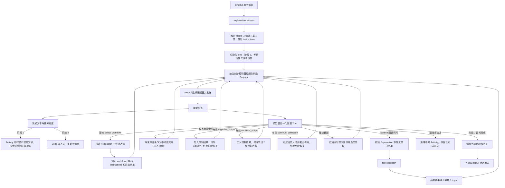

# Explanation 主对话 Agent

`explanation/` 实现阅读台右侧主对话。它通过 ChatKit 接收新消息，负责自己的 workflow 选择、工具循环、阶段切换、上下文和回复结束处理。Explanation 是共用双阶段显示公约的当前实现示例，公约本身见 [Agent 总览](../README.md)。

## Explanation 实际流程

图中阶段 1/2 分别对应取材和正式输出。Explanation 的首轮选择和阶段转换名称属于本 Agent。模型协议细节见[统一模型请求与响应](../model/README.md)。

每条新回复的首个 Request 只注册 `select_workflow`；只有模型返回完整调用后，loop 才验证并执行它、装入对应 instructions。阶段 1 正常结束但未调用 `organize_output` 时，loop 会额外请求一次仅允许该控制工具的响应；仍未切换则报错。

## 文件职责

| 文件或目录 | 职责 |
| --- | --- |
| `mod.rs` | 解析并固定路由；在调用处拼接 `system.md` 与短工具可用性规则；注册工具、启动循环并发送结束事件 |
| `agent_loop.rs` | 完整的 Explanation 状态机、工具白名单、阶段控制、截断续写、引用和片段边界 |
| `system.md` | 对话角色、安全边界、Source 使用、引用和回答要求 |
| `tool/explanation/` | `select_workflow` 与阶段控制 schema/handler；加载指引并返回可选的新开 Explanation 操作 |
| `tool/markdown.rs` | 只按编译期白名单读取内置 Markdown 指引，不接受任意路径 |
| `skill/explanation/` | 五类 Explanation 工作流各自的长 Markdown 指引 |
| `skill/` | 多 Agent 共用的跨学科阅读视角 |

所有指引通过 `include_str!` 编译进程序，当前没有用户编辑或覆盖设置。短固定 prompt 保留在使用它的模块中；工作流选择逻辑在 `agent/tool/explanation/`。

## 首轮与工作流提示词

每条新用户消息首轮必须调用注册表中的 `select_workflow`。它选择 Source 讲解、知识问题、伴读讨论、复盘或其他工作流，选择跨学科阅读视角，并返回是否建议另开 Explanation。它不生成线程标题，标题由 ChatKit 服务根据首条用户消息生成。

`agent/tool/explanation/` 中的 handler 校验模型返回的枚举，装入对应 workflow 指引和共用阅读视角。基础 instructions 在 `mod.rs` 中直接由 `system.md` 与一条短规则组成；规则对各 workflow 通用。模型在请求的 `tools` 字段里才能看到本轮真实开放的工具，system instructions 中列举规则不能代替工具注册。

## 阶段行为与验证

- **阶段 1 · 取材**：首轮只开放 `select_workflow`。后续按需开放 `list_sources`、`get_overview`、`read_source` 和 `organize_output`，以及统一的 `web_search` 意图。模型文本、真实工具状态和搜索进度使用临时 `Activity`。本机函数由当前注册表子集校验，再交 `tool::dispatch` 执行。函数结果和网页来源目录按顺序加入 `input`。
- **阶段转换**：`organize_output` 仅在阶段 1 有效，合法调用完成后下一轮进入阶段 2。若取材轮正常结束但没有转换，loop 会再发只要求 `organize_output` 的一轮；再次失败则报错。普通文本和不完整工具调用不触发转换。
- **阶段 2 · 正式输出**：进入阶段 2 前清理当前片段的临时 `Activity`，正文通过 `Delta` 写进同一条助手消息。`continue_output` 留在阶段 2，继续当前片段并保留正文位置和引用；`continue_collection` 结束当前片段后回到阶段 1。两个控制同时返回时视为冲突，留在阶段 2。
- **正常结束与截断**：阶段 2 正常结束且无有效控制调用时完成回复。服务商输出上限截断会在当前阶段自动续写，最多连续 8 次。单次回复最多 24 次模型请求、40 次本机工具调用。
- **失败与取消**：只在收到完整且有效的函数调用后应用控制。取消或错误清理临时播报并保留已完成正文与引用。工具参数、工具结果和模型层不透明 `Context` 不进入 UI。

一次运行中跨阶段保留完整 `input` 和模型返回的 opaque Context，以 `KeepAll` 使用当前消息历史。全量历史可能超出模型上下文上限，出现时报告请求错误，不删除已完成的正文和引用。

## Source 工具与引用

共享注册表提供 `list_sources`、`get_overview` 和 `read_source`。当前 Source 读取仅支持已导入 PDF。概览是阅读导航，不代替原文证据。需要引用时由 `read_source` 返回实际页码和本回复有效的 `rN` 编号。网页搜索返回的 URL 被校验后编为 `wN`，并作为不可信来源资料加回后续 `input`。

`agent/citation.rs` 缓冲跨 chunk 的 `[[cite:rN]]` / `[[cite:wN]]` 标记、校验目标并计算正文位置，ChatKit 再转换成可点击 PDF 页码或 URL 注释。临时编号不会持久化到 ACR。

## 新开 Explanation 建议

`select_workflow` 可以建议另开对话。建议在整条回复完成后才作为独立 ChatKit 确认操作显示，并不作为模型工具执行。后端将一次性操作绑定到当前线程的最新用户消息，10 分钟后过期。用户确认后只把该条用户原文预填到新线程草稿，用户点击发送才创建线程。过期、拒绝、重复确认或线程已有新消息时不会切换。

## 当前限制

当前只对 PDF 提供原文工具和页码引用。ChatGPT 路由可提供内建搜索，通用 API 路由明确没有搜索实现。线程、消息和运行期引用只保存在当前进程；Annotation、跨会话持久化、讲解文档版本和 ACR 读写尚未实现。
