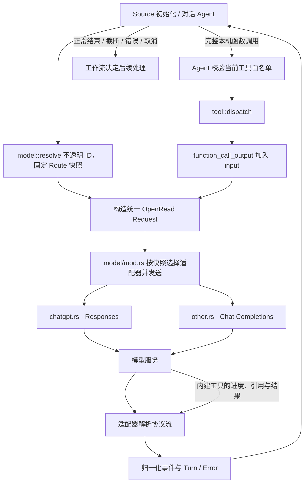

# Agent 统一模型请求与响应

`model/` 是 Agent 工作流访问模型的统一边界。调用方构造 OpenRead 请求，中心路由选择适配器，适配器负责服务商请求转换和响应协议解析。模型层不决定业务阶段、工具循环或显示去向。

## 请求格式

`Request` 包含已解析并固定的模型路由、顶层指令、有序输入、本轮工具清单、工具选择、流式和存储选项、适用的思考强度，以及模型层私有的续传上下文。下方 JSON 仅展示逻辑字段；Agent 先通过 `model::resolve` 把前端给出的不透明路由 ID 解析成路由快照，再构造请求。

```json
{
  "model": "selected-route",
  "instructions": "你是 OpenRead 的阅读助手。",
  "input": [
    {
      "role": "user",
      "content": [
        { "type": "input_text", "text": "请阅读这页 PDF。" },
        {
          "type": "input_image",
          "image_url": "data:image/png;base64,...",
          "detail": "auto"
        }
      ]
    }
  ],
  "tools": [
    {
      "type": "function",
      "name": "read_source",
      "description": "读取 PDF 页",
      "parameters": {
        "type": "object",
        "properties": {
          "source_id": { "type": "string" },
          "page_start": { "type": "integer", "minimum": 1 },
          "page_end": { "type": "integer", "minimum": 1 }
        },
        "required": ["source_id", "page_start", "page_end"],
        "additionalProperties": false
      }
    },
    { "type": "web_search" }
  ],
  "tool_choice": "auto",
  "stream": true,
  "store": false
}
```

`input` 也承载后续工具循环中的 assistant 调用与工具结果：

```json
[
  {
    "type": "function_call",
    "call_id": "call-1",
    "name": "read_source",
    "arguments": "{\"source_id\":\"00000000-0000-4000-8000-000000000001\",\"page_start\":1,\"page_end\":1}"
  },
  {
    "type": "function_call_output",
    "call_id": "call-1",
    "output": "读取到的原文内容"
  }
]
```

- system 指令放在 `instructions`。`input` 按顺序表达 user/assistant 消息、文字/图片块、函数调用和函数结果。
- `tools` 只描述本轮模型可用的函数或搜索意图。函数必须带名称、说明和 JSON Schema。Agent 根据自己的循环选择工具，模型请求注册和后端 dispatch 使用同一份允许列表。
- `web_search` 表达搜索意图。当前 ChatGPT 适配器将其映射到服务商内建搜索。通用 API 路由没有搜索实现，会明确告诉模型未搜索，不提供伪造结果。
- `tool_choice` 为 `none`、`auto` 或 `required`。无法实现必需工具的适配器返回明确错误。未知输入块和不支持工具由适配器拒绝。
- 当前交互请求使用流式传输。`store: false` 只表示请求不使用服务端对话存储能力，不承诺服务商不保留服务日志。
- 思考强度只适用于 ChatGPT 路由。自动值省略 API 字段；低、中、高传给 Responses API。其他适配器不替用户改写强度。

Responses API 的专有续传项目只保存在模型层的 `Context` 中。Agent 原样传递该值，不能解析、写进通用消息、显示事件或日志。

## 请求到 Agent loop 的完整流程



适配器只解析协议，不根据普通文本 chunk 猜测业务阶段。Agent 收到完整、校验通过的工具调用后执行本机工具，或消费服务商内建工具结果，然后决定是否发起下一轮。

## 响应接口

适配器解析产生的 `Event` 在模型层内部逐帧累积。`StreamEvent` 是工作流可订阅的有限流式接口，完整的一轮结果放在 `Turn`，请求和协议错误放在 `Error`。

| 统一结果 | 含义 |
| --- | --- |
| 内部 `Event::Text` | 一段文本增量，chunk 边界可能落在任意文字或结构内部 |
| 内部 `Event::ToolCallDelta` | 尚在累积的函数调用片段，未完成时不能执行 |
| 内部 `Event::SearchProgress` | 服务商内建搜索的实际进度事件 |
| 内部 `Event::Completed` / `Truncated` | 当前响应正常结束或触及输出上限，并携带可用的完整输出项目 |
| 内部 `Event::Failed` | 服务商流返回失败 |
| `StreamEvent::Text` / `SearchProgress` | 工作流接收的流式正文与搜索进度 |
| `Turn.text` / `tool_calls` | 一轮完整文本和通过结构完整性检查的函数调用 |
| `Turn.citations` | 服务商搜索返回的来源信息 |
| `Turn.context` | 模型层私有续传数据，Agent 只传递 |
| `Turn.truncated` | Agent 决定是否续写当前任务 |
| `Error::Cancelled` / `Request` / `Failed` | 取消、HTTP 请求失败或协议/流失败 |

函数调用增量只在模型层累积。响应结束后模型层检查调用 ID、名称和参数是否完整，再放入 `Turn.tool_calls`；JSON 参数与业务约束由 Agent loop 或工具 handler 校验。

只在服务商支持的情况下映射 `store: false` 和思考强度。取消优先于读取响应体和响应流；取消后工作流不能把未完成结果当作完成内容提交。图像被服务商拒绝时，模型层会标记错误类型，Source 初始化工作流再决定是否用纯文字重试。

## 服务商适配器

| OpenRead 字段 | ChatGPT Responses | 通用 Chat Completions |
| --- | --- | --- |
| `instructions` | Responses 顶层指令 | 转换成 system 消息 |
| user/assistant 输入 | Responses `input` 与内容块 | Chat Completions `messages` |
| `input_image` | Responses 图像块 | `image_url` 内容块 |
| function 工具 | Responses function 工具，置于 OpenRead namespace | Chat Completions function 工具 |
| 函数调用与结果 | `function_call` / `function_call_output` | assistant `tool_calls` / `role: tool` |
| `web_search` | Responses 内建搜索 | 当前无实现，明确报告不可用 |
| 续传状态 | 模型层不透明 `Context` | 无额外续传状态 |

当前仅有 `chatgpt.rs` 与 `other.rs`。路由由后端签发的不透明模型 ID 解析，不根据用户可编辑的服务商显示名称猜测协议。增加专用服务商时，适配器同时负责请求转换和响应解析；只有路由不能稳定识别协议时才扩展路由信息，并兼容旧配置。

## 子模块与使用位置

- `mod.rs` 定义统一请求、结果、事件、路由入口、通用 SSE 帧读取、取消优先级和通用错误处理。
- `chatgpt.rs` 转换 Responses 请求，处理 ChatGPT 授权检查、内建搜索、来源引用、图像拒绝和专属续传上下文。
- `other.rs` 转换通用 Chat Completions 请求，处理消息、函数调用、图像及该协议的流事件。
- Source 初始化在 `agent/initial/` 使用统一请求获取概览更新。Explanation 在 `agent/explanation/` 使用同一入口完成多轮工具和正文循环。两者共享模型协议，不共享业务阶段。
- Annotation 目前未实现，接入时应构造相同的 OpenRead 请求并自行管理它的 Agent loop。
