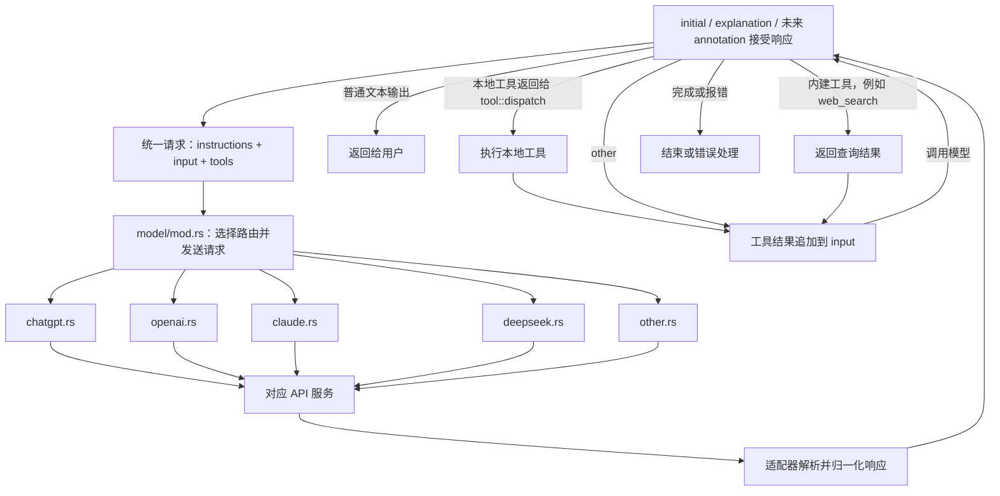

# Agent 模型请求格式与适配器路由

本文定义 OpenRead Agent 的统一请求格式、服务商适配器职责和请求/响应流程。统一请求与首阶段适配器已经实现；各 Agent 自己管理阶段和用户可见流向，供应商适配器不解释业务阶段。

## 目标统一请求格式

Agent 工作流只组装一份 OpenRead 请求。system 指令放在顶层 `instructions`，其他消息放在 `input`，可用工具放在 `tools`。`model` 表示当前选中的 OpenRead 模型路由；中心路由负责解析实际服务商、服务商模型名和认证信息。

```json
{
  "model": "selected-model",
  "instructions": "你是 OpenRead 的阅读助手。",
  "input": [
    {
      "role": "user",
      "content": [
        { "type": "input_text", "text": "请阅读这页 PDF。" },
        { "type": "input_text", "text": "【第 1 页页面图像】" },
        {
          "type": "input_image",
          "image_url": "data:image/png;base64,...",
          "detail": "auto"
        }
      ]
    }
  ],
  "tools": [
    {
      "type": "function",
      "name": "read_source",
      "description": "读取 PDF 页",
      "parameters": { "type": "object", "properties": {} }
    },
    { "type": "web_search" }
  ],
  "tool_choice": "auto",
  "stream": true,
  "store": false
}
```

`input` 还要能表示 assistant 的工具调用和工具结果，以便多轮工具对话能经过同一套内部格式：

```json
[
  {
    "type": "function_call",
    "call_id": "call-1",
    "name": "read_source",
    "arguments": "{\"page_start\":1,\"page_end\":1}"
  },
  {
    "type": "function_call_output",
    "call_id": "call-1",
    "output": "读取到的原文内容"
  }
]
```

格式约定：

- system 指令只放在 `instructions`；`input` 放 `user`、`assistant` 消息及工具调用/结果项。
- 消息 `content` 是有序内容块。当前需要 `input_text` 和 `input_image`；图片使用 PDF 工具层提供的 Data URL，页码等说明作为相邻文字块。
- `tools` 是统一工具清单，不增加表示“本机”或“服务商内建”的来源字段。`type` 表示工具语义/形状，由所选适配器决定如何转换。
- `function` 工具包含 `name`、`description` 和 JSON Schema 参数。模型返回函数调用后，Agent 循环把规范化调用交给 `tool::dispatch`；执行结果作为 `function_call_output` 加回 `input`。
- `web_search` 表示搜索意图。OpenAI 适配器可映射到服务商内建搜索；通用适配器可映射到已注册的本机搜索函数。目前没有本机搜索实现，因此通用适配器不提供搜索工具，并告知模型本轮不可搜索。
- `tool_choice` 使用 `none`、`auto`、`required`。若适配器无法提供本轮必需工具，应返回明确错误；不支持的可选工具不能静默伪装成已执行。
- `stream` 对当前 Agent 请求为 `true`。`store: false` 表示不请求服务商保存对话状态；适配器只在服务商协议支持时发送对应字段，不能据此承诺服务商不保留服务日志。
- `reasoning_effort` 是可选内部选项，目前只由 ChatGPT 路由使用；其他路由按其能力处理，不能擅自改成另一档强度。
- 当前只定义已有文字、函数工具、搜索意图和图片需求。文件上传等尚未实现的能力等进入功能范围时再增加规范，不预留任意供应商 JSON 扩展字段。

Responses 需要续传的原始推理/输出项目由模型层保存为不透明的适配器上下文。Agent 只原样传递，不检查其结构；不得把 Responses 原始项目泄漏到 ChatKit、通用消息字段或日志中。

## 适配器转换职责

每个适配器从统一请求生成对应服务商的请求，并把其流式响应转换成共同的 `ModelEvent` / `ModelTurn`。共同结果至少表达文本增量、函数调用、内建工具进度、引用、完成、截断和错误。

| OpenRead 内部字段 | Responses 适配 | Chat Completions 适配 |
| --- | --- | --- |
| `instructions` | 顶层 `instructions` | system role 消息 |
| user/assistant 文字 | `input` 消息及 `input_text` | `messages` 及 text content |
| 图片内容块 | `input_image` | `image_url` |
| 函数定义 | Responses function/namespace tool | function tool |
| assistant 函数调用 | `function_call` | assistant `tool_calls` |
| 函数结果 | `function_call_output` | `role: tool` 和 `tool_call_id` |
| `web_search` | OpenAI 支持时映射为内建搜索 | 有本机搜索处理器时映射为本机 function；当前没有则不可用 |
| `tool_choice` | Responses 对应选择字段 | Chat Completions 对应选择字段 |

适配器负责处理服务商特有的 namespace、响应帧、工具生命周期、引用格式和续传项；Agent 工作流不拼这些 wire JSON。服务商若已在同一请求中执行内建工具并返回最终文本，适配器将进度/引用和最终响应归一化后送回 Agent；若响应要求 Agent 再发一轮，则把规范化工具结果加回 `input` 后继续循环。

## Agent 阶段与流式事件

- `StreamEvent::Text` 表示一段文本增量。分块边界由服务商决定，单个增量可能只是 JSON 字符串或普通文本的一部分，不代表完整对象、字段或阶段标记。适配器只解析协议帧，不根据正文猜测内容用途。
- 完整的函数调用在响应终止后归入 `Turn.tool_calls`。调用参数必须完整并由该 Agent 本轮选出的注册工具或控制函数校验；业务阶段只由 Agent 自己决定。
- `model/mod.rs` 接收 Agent 当前请求选择的工具清单和 `tool_choice`。流式正文由 Agent loop 按发起请求前确定的显示去向路由到临时播报或正式回复。服务商适配器不推断或修改阶段。
- `SearchProgress`、最终文本、函数调用、引用、截断和错误仍按统一事件/结果返回。服务商专属续传数据仍由模型层放入不透明 `Context`，Agent 只原样传回。

Explanation 的双阶段循环见 [Explanation README](../explanation/README.md)。对话显示事件和共用引用解析见 [Agent README](../README.md) 及 `../citation.rs`；它们不包含 Agent loop。

## 目录和路由约定

- `model/mod.rs` 是唯一中心路由程序：根据已选模型路由确定适配器，取得现有凭据来源，调用适配器构造请求、发送并读取流，再把结果交回 Agent。
- 每个具体服务商适配器单独放在 `model/` 根目录的一个 `.rs` 文件中：目标模块名为 `chatgpt.rs`、`openai.rs`、`claude.rs`、`deepseek.rs`、`other.rs`。适配器内部同时负责请求转换和该服务商响应解析；不要把多个服务商解析塞进同一文件，也不为未实现服务商创建空占位文件。
- `chatgpt.rs` 处理 ChatGPT 登录路由；`openai.rs` 处理 OpenAI API 路由；`claude.rs`、`deepseek.rs` 是后续服务商适配器；`other.rs` 处理当前通用兼容服务商。
- 当前通用服务商配置没有稳定的适配器类型字段，不能靠用户可编辑的显示名称猜测具体服务商。目标路由需要使用稳定 `adapter_id`；旧配置缺少该字段时走 `other`。适配器列表由模型层提供，设置界面读取列表，新增适配器时不改 Agent 工作流或设置选项代码。
- 当前首阶段适配器为 `chatgpt.rs` 和 `other.rs`。`other` 表示通用 Chat Completions 兼容接口；由于 API 配置没有专属协议标识，不按显示名称猜测服务商，也不新增 `adapter_id`。其他专属服务商适配器仅在需求明确后增加。

## 完整请求与响应架构

以下流程图是目标处理流程，所有服务商响应都先归一化并回到 Agent 循环。Agent 根据结果决定返回文本、执行工具、补充 input 后续请求，或结束/报错。



## 当前实现状态

- `model/mod.rs` 是中心入口，在 Agent 任务开始时解析并持有当前路由快照，将 ChatGPT 登录路由交给 `chatgpt.rs`、API Key 路由交给 `other.rs`；每次请求仍由适配器检查当前凭据和配置，不需要改服务商配置格式。
- `initial/` 与 Explanation 自有 loop 都传递统一 `Request` 并消费归一化 `Turn`。`input` 支持有序文字/图片内容、函数调用和函数结果；本机函数由 Agent 本轮选择的注册工具验证后交给 `tool::dispatch`。ChatGPT 搜索进度、URL 引用、截断和错误由适配器归一，通用 API 在没有搜索实现时明确告知模型不可搜索。
- Responses 原始 output items 只保存在模型层 `Context` 中，Agent 只传递该不透明值；供应商请求体和 SSE 解码不再出现在工作流目录。
